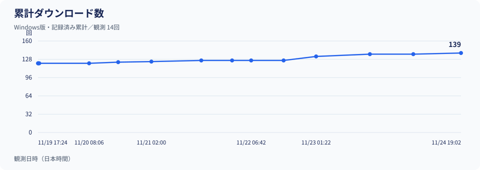
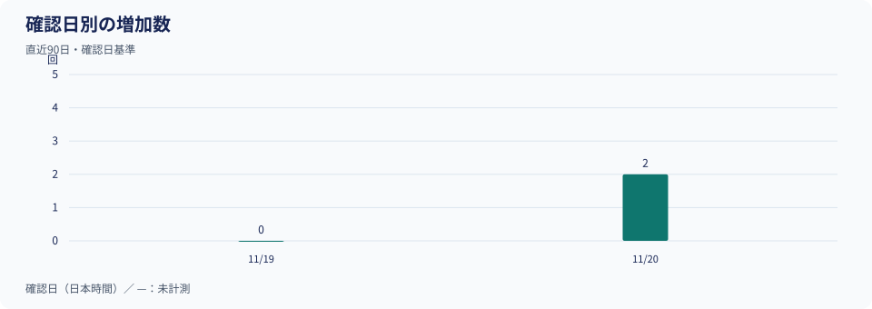

# FPS将棋 ダウンロード統計

最終更新：2026-11-24 19:02:34（日本時間）

| 指標 | 数値 |
| --- | ---: |
| 記録済み累計 | **139回** |
| 公開中ファイルの累計 | 139回 |
| 前回からの増加 | 2回 |
| 対象リリース数 | 34件 |

## グラフ

## 最近の推移

| 日時（日本時間） | 累計 | 増加 |
| --- | ---: | ---: |
| 2026-11-24 19:02:34 | 139 | 2 |
| 2026-11-24 05:19:23 | 137 | 0 |
| 2026-11-23 16:50:34 | 137 | 4 |
| 2026-11-23 01:22:41 | 133 | 7 |
| 2026-11-22 16:01:56 | 126 | 0 |
| 2026-11-22 06:42:04 | 126 | 0 |
| 2026-11-22 01:12:43 | 126 | 0 |
| 2026-11-21 16:21:28 | 126 | 2 |
| 2026-11-21 02:00:38 | 124 | 1 |
| 2026-11-20 16:27:41 | 123 | 2 |
| 2026-11-20 08:06:04 | 121 | 0 |
| 2026-11-19 17:45:27 | 121 | 0 |
| 2026-11-19 17:30:35 | 121 | 0 |
| 2026-11-19 17:24:23 | 121 | — |

## バージョン別

| バージョン | ダウンロード数 | 状態 |
| --- | ---: | --- |
| [v0.20.0](https://github.com/dugite-git/FPSshogi-Releases/releases/tag/v0.20.0) | 2 | 公開中 |
| [v0.19.8](https://github.com/dugite-git/FPSshogi-Releases/releases/tag/v0.19.8) | 2 | 公開中 |
| [v0.19.7](https://github.com/dugite-git/FPSshogi-Releases/releases/tag/v0.19.7) | 9 | 公開中 |
| [v0.19.2](https://github.com/dugite-git/FPSshogi-Releases/releases/tag/v0.19.2) | 10 | 公開中 |
| [v0.19.1](https://github.com/dugite-git/FPSshogi-Releases/releases/tag/v0.19.1) | 3 | 公開中 |
| [v0.19.0](https://github.com/dugite-git/FPSshogi-Releases/releases/tag/v0.19.0) | 2 | 公開中 |
| [v0.18.25](https://github.com/dugite-git/FPSshogi-Releases/releases/tag/v0.18.25) | 2 | 公開中 |
| [v0.18.24](https://github.com/dugite-git/FPSshogi-Releases/releases/tag/v0.18.24) | 6 | 公開中 |
| [v0.18.23](https://github.com/dugite-git/FPSshogi-Releases/releases/tag/v0.18.23) | 7 | 公開中 |
| [v0.18.22](https://github.com/dugite-git/FPSshogi-Releases/releases/tag/v0.18.22) | 4 | 公開中 |
| [v0.18.21](https://github.com/dugite-git/FPSshogi-Releases/releases/tag/v0.18.21) | 4 | 公開中 |
| [v0.18.20](https://github.com/dugite-git/FPSshogi-Releases/releases/tag/v0.18.20) | 3 | 公開中 |
| [v0.18.19](https://github.com/dugite-git/FPSshogi-Releases/releases/tag/v0.18.19) | 3 | 公開中 |
| [v0.18.18](https://github.com/dugite-git/FPSshogi-Releases/releases/tag/v0.18.18) | 3 | 公開中 |
| [v0.18.17](https://github.com/dugite-git/FPSshogi-Releases/releases/tag/v0.18.17) | 3 | 公開中 |
| [v0.18.16](https://github.com/dugite-git/FPSshogi-Releases/releases/tag/v0.18.16) | 5 | 公開中 |
| [v0.18.15](https://github.com/dugite-git/FPSshogi-Releases/releases/tag/v0.18.15) | 6 | 公開中 |
| [v0.18.14](https://github.com/dugite-git/FPSshogi-Releases/releases/tag/v0.18.14) | 4 | 公開中 |
| [v0.18.13](https://github.com/dugite-git/FPSshogi-Releases/releases/tag/v0.18.13) | 5 | 公開中 |
| [v0.18.12](https://github.com/dugite-git/FPSshogi-Releases/releases/tag/v0.18.12) | 5 | 公開中 |
| [v0.18.11](https://github.com/dugite-git/FPSshogi-Releases/releases/tag/v0.18.11) | 3 | 公開中 |
| [v0.18.10](https://github.com/dugite-git/FPSshogi-Releases/releases/tag/v0.18.10) | 3 | 公開中 |
| [v0.18.9](https://github.com/dugite-git/FPSshogi-Releases/releases/tag/v0.18.9) | 7 | 公開中 |
| [v0.18.8](https://github.com/dugite-git/FPSshogi-Releases/releases/tag/v0.18.8) | 3 | 公開中 |
| [v0.18.7](https://github.com/dugite-git/FPSshogi-Releases/releases/tag/v0.18.7) | 3 | 公開中 |
| [v0.18.6](https://github.com/dugite-git/FPSshogi-Releases/releases/tag/v0.18.6) | 2 | 公開中 |
| [v0.18.5](https://github.com/dugite-git/FPSshogi-Releases/releases/tag/v0.18.5) | 2 | 公開中 |
| [v0.18.4](https://github.com/dugite-git/FPSshogi-Releases/releases/tag/v0.18.4) | 5 | 公開中 |
| [v0.18.3](https://github.com/dugite-git/FPSshogi-Releases/releases/tag/v0.18.3) | 3 | 公開中 |
| [v0.18.2](https://github.com/dugite-git/FPSshogi-Releases/releases/tag/v0.18.2) | 2 | 公開中 |
| [v0.18.1](https://github.com/dugite-git/FPSshogi-Releases/releases/tag/v0.18.1) | 2 | 公開中 |
| [v0.18.0](https://github.com/dugite-git/FPSshogi-Releases/releases/tag/v0.18.0) | 3 | 公開中 |
| [v0.17.2](https://github.com/dugite-git/FPSshogi-Releases/releases/tag/v0.17.2) | 8 | 公開中 |
| [v0.17.1](https://github.com/dugite-git/FPSshogi-Releases/releases/tag/v0.17.1) | 5 | 公開中 |
